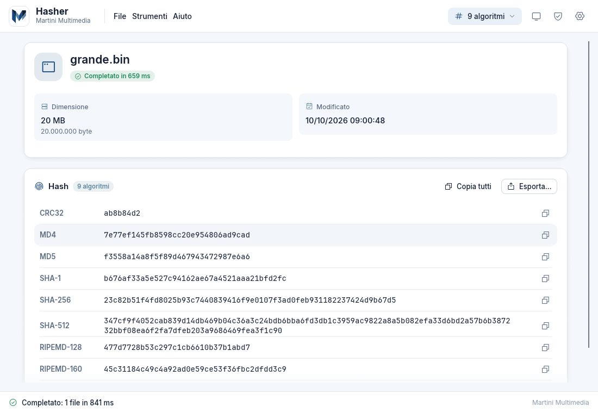
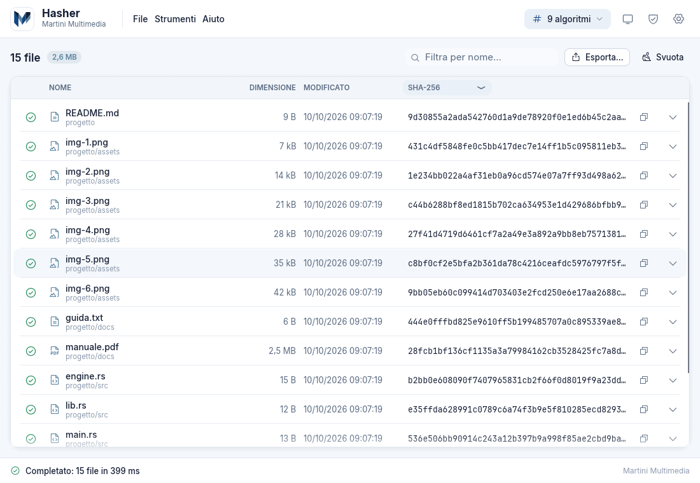
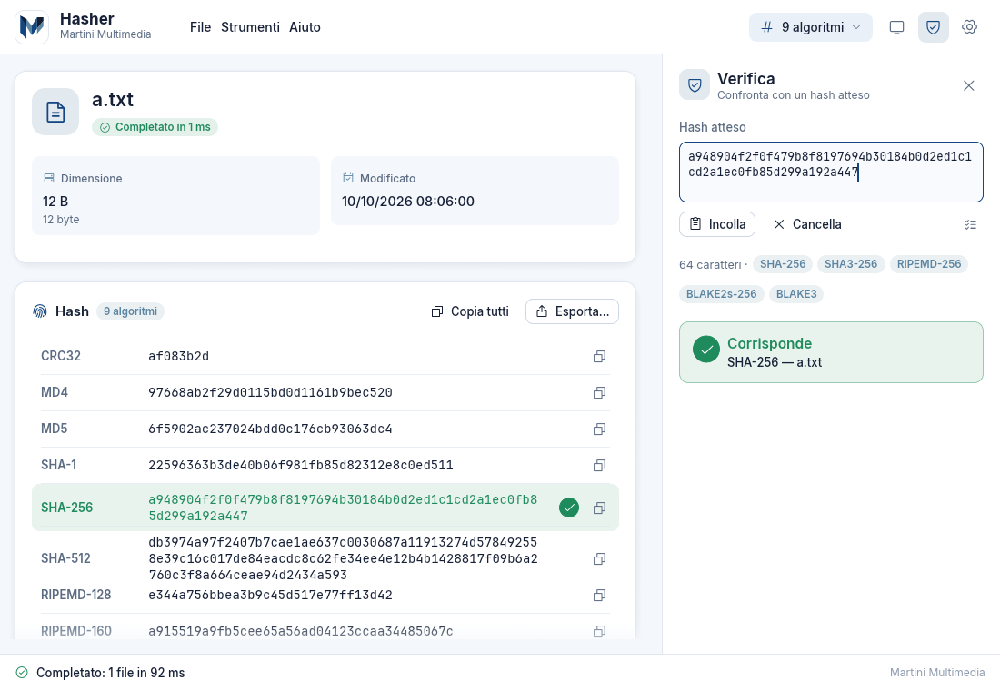
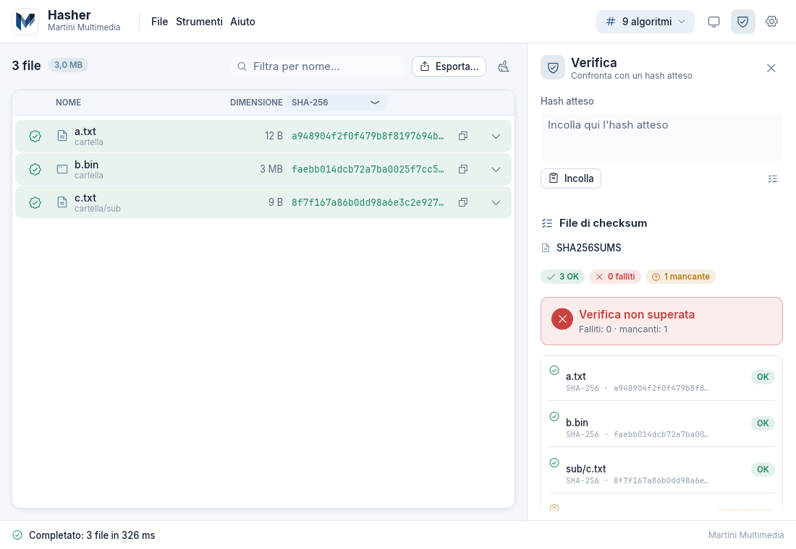
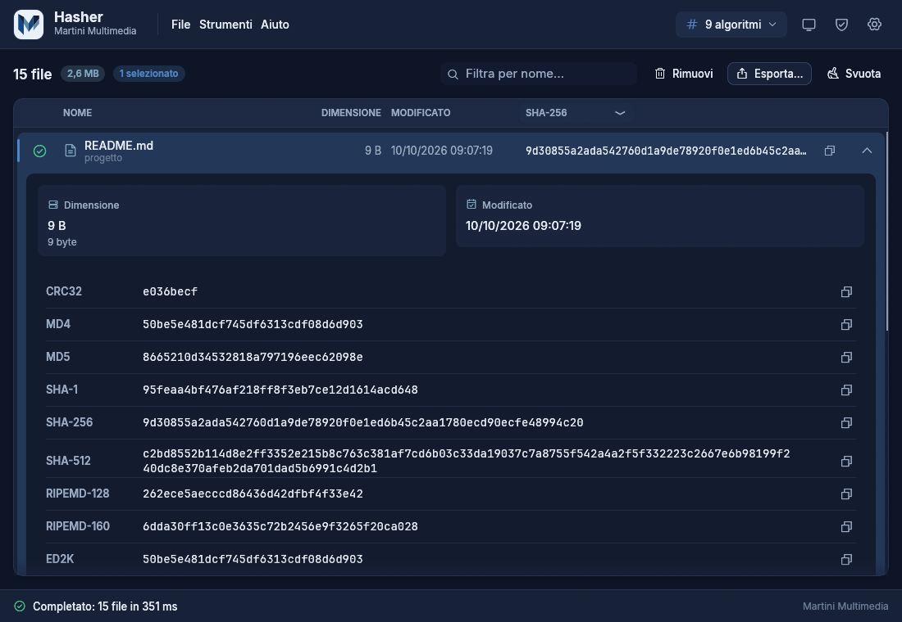
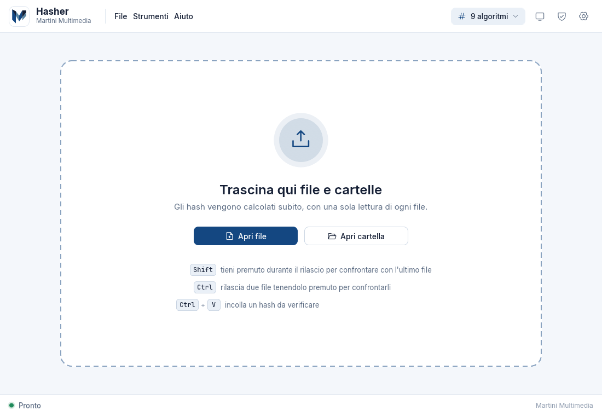

<p align="center">
  
</p>

<h1 align="center">Hasher Web</h1>

<p align="center">
  La versione web (PWA) di <a href="https://github.com/inalto/hasher">Hasher</a>: calcola e verifica gli hash
  dei tuoi file <b>direttamente nel browser</b>. Nessun file viene inviato online.
</p>

<p align="center">
  <b>English:</b> Hasher Web is the web (PWA) edition of <a href="https://github.com/inalto/hasher">Hasher</a>, the hash
  calculator and verifier by Martini Multimedia s.a.s. All hashing runs <b>inside your browser</b> (Rust compiled to
  WebAssembly, in Web Workers): files are never uploaded. It ships as a tiny container image
  (<code>ghcr.io/inalto/hasher-web</code>) that serves static files behind your HTTPS reverse proxy, and it can be
  installed as an app from Chrome or Edge. The deployment guide (in Italian) is
  <a href="docs/DEPLOY.md">docs/DEPLOY.md</a>; ready-made nginx, Caddy, Traefik and Apache examples are in
  <a href="deploy/">deploy/</a>.
</p>

<p align="center">
  <a href="https://github.com/inalto/hasher-web/actions/workflows/ci.yml"></a>
  <a href="https://github.com/inalto/hasher-web/pkgs/container/hasher-web"></a>
  <a href="https://github.com/inalto/hasher-web/releases/latest"></a>
</p>

---

Hasher Web è scritto in Rust puro: l'interfaccia è la **stessa dell'app desktop**
([egui/eframe](https://github.com/emilk/egui)) compilata in WebAssembly e disegnata su un canvas WebGL2, gli hash
sono calcolati da **Web Worker** (WebAssembly) che leggono i file a blocchi, e un piccolo server
[axum](https://github.com/tokio-rs/axum) serve i file statici da un contenitore Docker/Podman dietro a un reverse
proxy. Trascini uno o più file (o cartelle) sulla pagina e ottieni subito tutti gli hash, calcolati in parallelo con
**un'unica lettura** del file. L'app è installabile come PWA (barra delle applicazioni di Windows, dock di macOS) e
funziona anche offline dopo la prima visita.

## Screenshot

<p align="center">
  
  
</p>
<p align="center">
  
  
</p>
<p align="center">
  
  
</p>

Le schermate sono catturate dalla versione web in Chromium: l'interfaccia è la stessa dell'app desktop.

## Privacy

**Nessun file lascia il tuo computer.** Il server serve solo i file statici dell'applicazione e `/healthz`: non ha
endpoint per ricevere dati, né upload, né database. I file vengono letti dal browser a blocchi (`File.slice`) ed
elaborati dai Web Worker, quindi nemmeno i file da decine di GB vengono caricati per intero in memoria. Se scegliendo
una cartella il browser chiede «Caricare N file?» è il suo testo standard per i selettori di cartelle: non viene
caricato nulla (puoi verificarlo dagli strumenti di rete del browser). Le impostazioni restano nel `localStorage` del
tuo browser.

## Avvio rapido

```sh
docker run -d --name hasher-web --restart unless-stopped \
  -p 127.0.0.1:8080:8080 \
  ghcr.io/inalto/hasher-web:latest
```

Apri <http://localhost:8080>: su `localhost` il browser consente già l'installazione come app e il service worker.
Con **podman** il comando è identico (sostituisci `docker` con `podman`). Per metterlo online serve un reverse proxy
con **HTTPS** (obbligatorio per PWA e service worker): esempi per nginx, Caddy, Traefik e Apache sono in
[`deploy/`](deploy/), l'avvio con compose in [`compose.yaml`](compose.yaml), e tutto il resto (variabili d'ambiente,
prefisso di percorso, aggiornamenti, risoluzione dei problemi) in **[docs/DEPLOY.md](docs/DEPLOY.md)**.

## Funzionalità

Le stesse dell'[app desktop](https://github.com/inalto/hasher), nello stesso aspetto.

### Algoritmi di hash

| Gruppo | Algoritmi |
|---|---|
| Checksum | CRC32, CRC64 (XZ/ECMA), xxHash64, xxHash3-128 |
| MD | MD2, MD4, MD5 |
| SHA | SHA-1, SHA-224, SHA-256, SHA-384, SHA-512, SHA3-256, SHA3-512 |
| RIPEMD | RIPEMD-128, RIPEMD-160, RIPEMD-256, RIPEMD-320 |
| BLAKE | BLAKE2b-512, BLAKE2s-256, BLAKE3 |
| P2P | ED2K (convenzione eMule: blocchi da 9.728.000 byte) |

Di default sono attivi CRC32, MD4, MD5, SHA-1, SHA-256, SHA-512, RIPEMD-128, RIPEMD-160 ed ED2K; gli altri si attivano
dalle impostazioni. MD2 è disponibile ma non è attivo di default: è un algoritmo seriale e lento.

### Uso

- **File singolo**: scheda con nome, dimensione (leggibile ed esatta in byte), data di modifica e una riga per ogni
  hash con pulsante *copia*.
- **Più file e cartelle**: tabella con nome, dimensione, data, stato (in coda / in corso / completato / errore) e
  l'hash dell'algoritmo scelto; ogni riga si espande per mostrare tutti gli hash. Barra di stato con avanzamento
  complessivo, velocità (MB/s) e tempo stimato, pulsante *Annulla*. Le cartelle trascinate vengono esplorate
  (ricorsione e file nascosti configurabili).
- **Drag & drop**: trascina file o cartelle sulla pagina; la zona di rilascio pulsa quando un file è sopra
  l'applicazione. Rilasciando con **Shift** o **Ctrl** premuto i file vengono confrontati tra loro (dettagli nella
  guida integrata, `F1`). In alternativa `Ctrl+O` e `Ctrl+Shift+O` aprono il selettore di file o di cartelle.
- **Calcolo in parallelo nel browser**: un pool di Web Worker (uno per core, al massimo 8). Con più file ogni worker
  elabora un file; con un file solo gli algoritmi vengono ripartiti fra i worker.

### Verifica

- **Hash incollato**: incolla un hash atteso (`Ctrl+V`); Hasher ignora spazi, due punti e maiuscole, riconosce
  l'algoritmo dalla lunghezza e mostra *Corrisponde (SHA-256)* oppure *Nessuna corrispondenza*. In lista evidenzia il
  file che corrisponde.
- **File di checksum**: trascinando un file `.md5`, `.sha1`, `.sha256`, `.sha512` o `.sfv` (formato GNU coreutils
  `hash  nome` oppure BSD `ALGO (nome) = hash`) insieme ai file da controllare, o nella cartella che li contiene,
  vengono verificati tutti i file elencati, con esito OK / FALLITO / MANCANTE per ciascuno.
- **Confronto tra due file**: selezionando due righe (o con Shift/Ctrl al rilascio) Hasher indica, algoritmo per
  algoritmo, se i due file sono identici.

### Esportazione

TXT (rapporto leggibile), CSV, JSON, XLSX (Excel), DOCX (Word) e **file di checksum** (`.sha256`, `.md5`, … in formato
GNU, riutilizzabile per la verifica con `sha256sum -c` o con Hasher stesso). Il file viene scaricato dal browser con il
nome `hasher-AAAAMMGG-HHMMSS.<estensione>`.

### Interfaccia e impostazioni

- **5 lingue**: italiano, inglese, francese, tedesco e spagnolo; di default segue la lingua del browser, con cambio
  immediato dalle impostazioni.
- **Tema chiaro/scuro automatico**: segue il sistema operativo, con scelta manuale.
- **Impostazioni persistenti** nel `localStorage` del browser (chiave `hasher.settings`).
- **Scorciatoie**: `Ctrl+O` apri file · `Ctrl+Shift+O` apri cartella · `Ctrl+E` esporta · `Ctrl+V` incolla hash da
  verificare · `Ctrl+,` impostazioni · `F1` guida · `Esc` annulla/chiudi · `Canc` rimuovi le righe selezionate ·
  `Ctrl+L` svuota l'elenco.

### Installazione come app (PWA) e uso offline

Da Chrome o Edge (con HTTPS, oppure su `localhost`) compare la voce **Installa Hasher** nella barra degli indirizzi e,
nell'app stessa, **Aiuto → Installa come app**. Installata, Hasher ha una propria finestra, si può agganciare alla barra
delle applicazioni di Windows o al dock di macOS e, con **Apri con**, apre i file di checksum (`.sha256`, `.md5`, …)
direttamente in verifica. Un service worker memorizza l'applicazione: dopo la prima visita funziona anche senza rete, e
una nuova versione viene scaricata in background e usata alla visita successiva.

## Differenze rispetto all'app desktop

I limiti dipendono dal browser, che non dà alle pagine web accesso al file system:

| Desktop | Web |
|---|---|
| Percorso completo del file | Nome del file, o percorso relativo alla cartella trascinata |
| Data di creazione, attributi, permessi | Non disponibili: la scheda mostra dimensione e data di modifica |
| "Apri cartella" nella scheda del file | Non presente |
| Dialoghi nativi di apertura e salvataggio | Selettori di file del browser; l'esportazione è un download |
| File di checksum: i file elencati si cercano su disco | Si cercano fra i file già in elenco o rilasciati insieme (stesso drop o stessa cartella); gli altri risultano MANCANTE |
| Export di un file di checksum con il solo nome del file | Con il percorso relativo alla cartella trascinata (`cartella/sub/file`), verificabile con `sha256sum -c` dalla cartella superiore o rilasciando di nuovo cartella e file di checksum insieme |
| Impostazioni portable accanto all'eseguibile | Impostazioni nel `localStorage` del browser |
| "Segui i link simbolici", menu File → Esci, riga di comando | Non presenti |
| Parallelismo con rayon | Pool di Web Worker (al massimo 8) |

L'interfaccia è disegnata su un canvas (come nell'app desktop): la selezione del testo nativa del browser e
l'accessibilità sono limitate, e l'uso da telefono non è ottimizzato.

## Compilare dal sorgente

Requisiti: [Rust](https://rustup.rs) stable **≥ 1.95** (`rust-version` in `Cargo.toml`), il target
`wasm32-unknown-unknown`, la CLI **`wasm-bindgen` con la stessa versione del crate in `Cargo.lock`** (lo script la
verifica), `brotli` e `gzip` per i file precompressi e, facoltativo, **binaryen** (`wasm-opt`) per ridurre i `.wasm`.

```sh
rustup target add wasm32-unknown-unknown
# versione del crate wasm-bindgen nel lock (ora 0.2.129):
WBG="$(sed -n '/^name = "wasm-bindgen"$/{n;s/^version = "\(.*\)"/\1/p}' Cargo.lock | head -n1)"
cargo install --locked wasm-bindgen-cli --version "$WBG"   # oppure il tarball precompilato delle release di wasm-bindgen

scripts/build-web.sh                           # compila app e worker in wasm → dist/ (con .br e .gz)
cargo build --release -p hasher-web-server     # embedda dist/ nel binario target/release/hasher-web-server
HASHER_WEB_BIND=127.0.0.1:8080 target/release/hasher-web-server
```

`dist/` deve essere pronta *prima* di compilare il server, che la incorpora nel binario. Per l'immagine del contenitore
tutto questo (compresa l'installazione degli strumenti) è nel `Dockerfile`:
`podman build --format docker -t hasher-web .` (vedi [docs/DEPLOY.md](docs/DEPLOY.md)).

Ciclo di sviluppo: `scripts/dev.sh` compila l'app in debug e avvia il server (che in debug legge `dist/` dal disco a
ogni richiesta) su <http://127.0.0.1:8080>; dopo una modifica basta rilanciare `scripts/build-web.sh --debug` e
ricaricare la pagina.

## Sviluppo

```sh
cargo test                                    # hasher-core e hasher-web-server (default-members)
cargo fmt --all --check                       # formattazione (rustfmt.toml)
cargo clippy --workspace --all-targets -- -D warnings
cargo clippy --target wasm32-unknown-unknown -p hasher-web-app -- -D warnings
cargo clippy --target wasm32-unknown-unknown -p hasher-core --features worker -- -D warnings
```

L'interfaccia esiste solo per wasm32 (sul target nativo `hasher-web-app` è un `main` vuoto, così i comandi senza `-p`
restano rapidi). I test del server non usano `dist/`: puntano la stessa implementazione di produzione alla cartella
`crates/hasher-web-server/testdata/`.

La CI (`.github/workflows/ci.yml`) esegue queste verifiche a ogni push e pull request verso `main`, costruisce `dist/` e
il server in release e, a ogni push su `main`, pubblica l'immagine su GHCR (`latest` e `sha-<commit>`). Per pubblicare una
versione basta un tag (`git tag v0.1.0 && git push origin v0.1.0`): `release.yml` controlla che coincida con la
`version` di `Cargo.toml`, pubblica l'immagine (`vX.Y.Z`, `X.Y.Z`, `X.Y`, `latest`) e crea la release con
`hasher-web-<versione>-linux-x86_64.tar.gz` (server, `README.md`, `docs/DEPLOY.md`, `deploy/`) e `SHA256SUMS.txt`.

### Struttura del progetto

```
hasher-web/
├── Cargo.toml                   workspace (default-members: core + server; l'app è wasm32)
├── .cargo/config.toml           jobs = 2 (compilazioni leggere)
├── crates/
│   ├── hasher-core/             algoritmi, parser dei checksum, esportazione, Web Worker (nativo e wasm32)
│   ├── hasher-web-app/          app egui in wasm32: ui/, engine/ (pool di worker), web/ (DOM), assets/, locales/
│   └── hasher-web-server/       server axum: serve dist/ (rust-embed), /healthz, precompressi, CSP; tests/, testdata/
├── web/                         index.html, boot.js, worker.js, manifest, service worker (template), icone
├── scripts/                     build-web.sh (wasm → dist/), dev.sh (ciclo di sviluppo)
├── dist/                        output della build (ignorato da git)
├── Dockerfile, compose.yaml     immagine multi-stage (distroless) e avvio con compose
├── deploy/                      esempi: nginx, Caddy, Traefik, Apache
├── docs/                        PIANO.md (progetto), DEPLOY.md (installazione e gestione)
└── .github/                     workflow ci.yml e release.yml, azione composita setup-web-build
```

## Crediti e licenze

- Font **Inter** e **JetBrains Mono**: [SIL Open Font License 1.1](https://openfontlicense.org); i testi delle licenze
  sono in `crates/hasher-web-app/assets/fonts/` e nella cartella `LICENSES-fonts/` dei pacchetti.
- Icone **Phosphor** (crate `egui-phosphor`): MIT.
- **egui** / **eframe** (Emil Ernerfeldt e contributori): MIT o Apache-2.0.
- Algoritmi di hash: famiglia **RustCrypto** (MD2, MD4, MD5, SHA-1/2/3, RIPEMD, BLAKE2: MIT o Apache-2.0),
  **BLAKE3** (CC0-1.0 o Apache-2.0), `crc32fast` e `crc` (MIT o Apache-2.0), `xxhash-rust` (BSL-1.0).
- Server: **axum**, **tokio**, **tower-http**, **rust-embed** e **tracing**: MIT.
- Altre dipendenze notevoli: `wasm-bindgen`, `web-sys` e `js-sys` (MIT o Apache-2.0), `rust_xlsxwriter` (XLSX),
  `docx-rs` (DOCX), `rust-i18n`, `serde`. L'elenco completo è nei `Cargo.toml` e in `Cargo.lock`.

© Martini Multimedia s.a.s.
